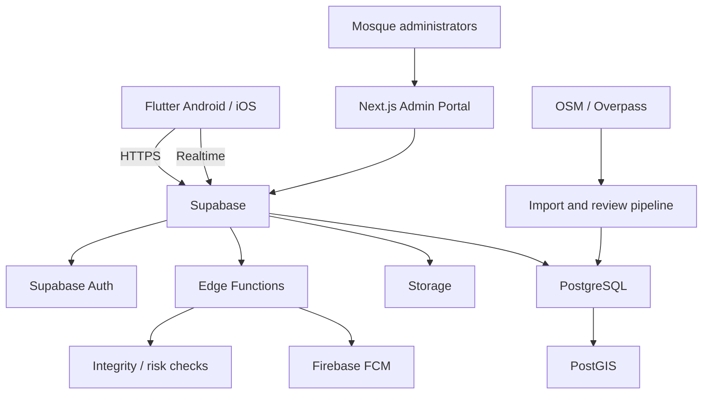
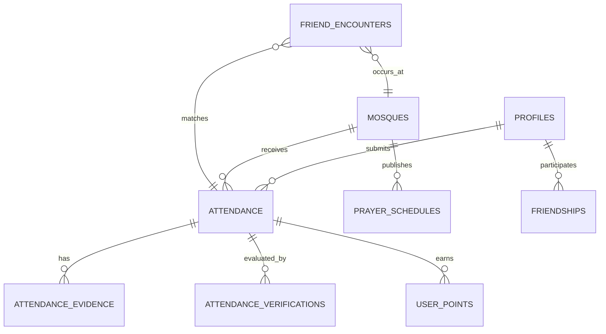
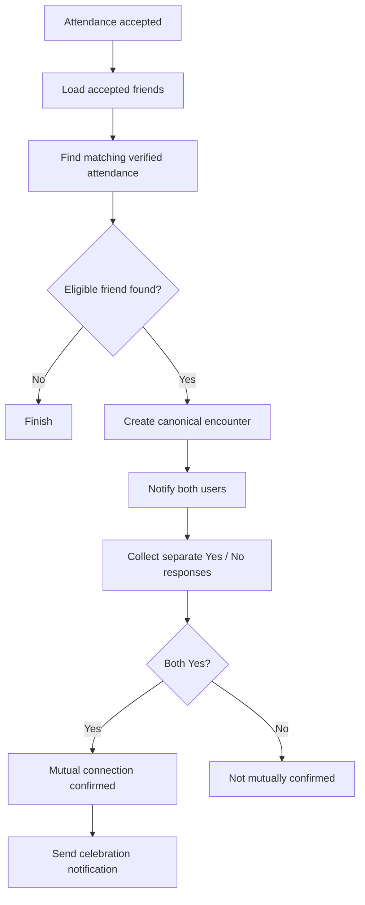

# Flutter Prayer Reminder & Mosque-Based Gamification Application

## Complete Technical Integration Guide

**Document status:** Architecture and implementation specification\
**Target platform:** Android and iOS\
**Initial geography:** Kerala, India\
**Recommended stack:** Flutter, Riverpod, Supabase, PostgreSQL/PostGIS,
Firebase Cloud Messaging, OpenStreetMap and a Next.js admin portal

------------------------------------------------------------------------

## 1. Executive summary

This application combines five daily Salah reminders, mosque discovery,
mosque-specific prayer schedules, attendance evidence, points and
leaderboards, and opt-in social connections based on shared mosque
attendance.

The recommended architecture is:

-   **Flutter** for Android and iOS.
-   **Riverpod** for application state and dependency injection.
-   **GoRouter** for navigation.
-   **Supabase Auth** for authentication.
-   **PostgreSQL** for relational application data.
-   **PostGIS** for geospatial queries.
-   **Supabase Storage** for private attendance evidence.
-   **Supabase Edge Functions and database functions** for trusted
    business logic.
-   **Firebase Cloud Messaging (FCM)** for server-triggered push
    notifications.
-   **Local notifications** for scheduled prayer reminders.
-   **OpenStreetMap (OSM)** as an initial mosque-data discovery source,
    supplemented by community and mosque-admin submissions.
-   **Adhan Dart or another validated prayer-calculation
    implementation** for calculated prayer start times.
-   **Next.js** for the web-based administration dashboard.
-   **Rive, Lottie and Flutter animations** for social and gamification
    experiences.

The backend, not the mobile application, must make authoritative
decisions about attendance verification, points, leaderboards and friend
encounters.

### Core product modules

1.  **Salah:** prayer calculations, mosque schedules, Adhan and
    reminders.
2.  **Mosque directory:** mosque records, maps, nearby discovery and
    administration.
3.  **Attendance:** camera evidence, GPS, timestamps, QR verification
    and review.
4.  **Gamification:** points, streaks, achievements and leaderboards.
5.  **Social:** friendships, shared-attendance encounters and mutual
    connection responses.
6.  **Administration:** mosque, timetable, user, attendance and rewards
    management.

------------------------------------------------------------------------

## 2. Architecture overview



### Responsibility boundaries

  -----------------------------------------------------------------------
  Component                           Responsibility
  ----------------------------------- -----------------------------------
  Flutter                             UI, permissions, local caching,
                                      camera, location collection, local
                                      reminders

  Supabase Auth                       Identity and sessions

  PostgreSQL                          Authoritative records and
                                      transactions

  PostGIS                             Nearby mosque and distance queries

  Edge Functions                      Trusted application workflows and
                                      external service calls

  Storage                             Private attendance photographs

  FCM                                 Social and server-generated push
                                      notifications

  Next.js                             Administrative workflows and
                                      reporting

  OSM import pipeline                 Initial geographic discovery,
                                      deduplication and review
  -----------------------------------------------------------------------

### Important security rule

Do not let the Flutter client directly:

-   Mark attendance as verified.
-   Award or edit points.
-   Create a confirmed friend encounter.
-   Change historical attendance.
-   Approve mosque records.
-   Modify official prayer schedules.

The app submits evidence and requests actions. Trusted backend logic
validates and performs them.

------------------------------------------------------------------------

## 3. Flutter project architecture

Use a feature-first architecture with clear UI, domain and data
boundaries. MVVM-style view models or Riverpod notifiers can coordinate
presentation state.

### Recommended folder structure

``` text
lib/
├── main.dart
├── bootstrap.dart
├── core/
│   ├── config/
│   ├── constants/
│   ├── errors/
│   ├── extensions/
│   ├── network/
│   ├── permissions/
│   ├── services/
│   │   ├── location_service.dart
│   │   ├── notification_service.dart
│   │   ├── audio_service.dart
│   │   ├── camera_service.dart
│   │   └── connectivity_service.dart
│   ├── theme/
│   └── utils/
├── features/
│   ├── authentication/
│   │   ├── data/
│   │   ├── domain/
│   │   └── presentation/
│   ├── onboarding/
│   ├── home/
│   ├── prayer_times/
│   ├── prayer_reminders/
│   ├── mosques/
│   ├── attendance/
│   ├── gamification/
│   ├── leaderboard/
│   ├── friends/
│   ├── encounters/
│   ├── notifications/
│   ├── profile/
│   └── settings/
├── shared/
│   ├── models/
│   ├── widgets/
│   └── components/
└── routing/
    └── app_router.dart
```

Within each substantial feature:

``` text
attendance/
├── data/
│   ├── datasources/
│   ├── models/
│   └── repositories/
├── domain/
│   ├── entities/
│   ├── repositories/
│   └── usecases/
└── presentation/
    ├── screens/
    ├── widgets/
    └── providers/
```

### State management: Riverpod

Use Riverpod for:

-   Authentication state.
-   Selected mosque and location.
-   Prayer schedule and reminder preferences.
-   Attendance submission state.
-   Leaderboard and score state.
-   Friend and encounter state.
-   Realtime subscriptions.

Install:

``` bash
flutter pub add flutter_riverpod
flutter pub add riverpod_annotation
flutter pub add riverpod_generator
flutter pub add build_runner
```

Example:

``` dart
final prayerTimesProvider =
    FutureProvider<List<PrayerTime>>((ref) async {
  final repository = ref.read(prayerRepositoryProvider);
  return repository.getTodayPrayerTimes();
});
```

Keep business logic in repositories, services and use cases, not
directly inside widgets.

### Navigation

``` bash
flutter pub add go_router
```

Suggested route tree:

``` text
/splash
/auth
/onboarding
/home
/prayer-times
/mosques
/mosques/:mosqueId
/attendance
/attendance/history
/leaderboard
/friends
/encounters/:encounterId
/profile
/settings
```

Protect authenticated routes and check role-based access on the backend
as well as in the UI.

------------------------------------------------------------------------

## 4. Backend and database selection

### Why Supabase and PostgreSQL

The data is highly relational:

-   A user has many attendance records.
-   A mosque has many schedules.
-   Attendance belongs to a user, mosque and prayer session.
-   Friendships connect two users.
-   Encounters link two verified attendance records.
-   Points are derived from accepted attendance.

PostgreSQL is a natural fit for these relationships, constraints,
transactions and reporting. PostGIS adds indexed geographic operations.

Firebase can still be used for FCM. It is not necessary to use Firestore
as the primary database.

### Supabase services

  Service          Use
  ---------------- -----------------------------------------
  Auth             Phone OTP, email and social login
  Database         PostgreSQL records
  PostGIS          Geographic distance and radius searches
  Storage          Private evidence images
  Edge Functions   Trusted workflows and FCM sending
  Realtime         Authorized encounter and score updates
  Cron             Scheduled processing and cleanup

Official documentation:

-   Supabase Flutter:
    https://supabase.com/docs/guides/getting-started/quickstarts/flutter
-   PostGIS:
    https://supabase.com/docs/guides/database/extensions/postgis
-   Supabase Auth: https://supabase.com/docs/guides/auth
-   Storage: https://supabase.com/docs/guides/storage
-   Edge Functions: https://supabase.com/docs/guides/functions
-   Realtime: https://supabase.com/docs/guides/realtime

### Environments

Create separate development, staging and production projects. Each must
have separate credentials, storage buckets, Firebase configuration and
deployment secrets.

------------------------------------------------------------------------

## 5. Database design

Create version-controlled SQL migrations. Do not keep the whole schema
in one large SQL file.

Suggested migrations:

``` text
supabase/
├── migrations/
│   ├── 001_extensions.sql
│   ├── 002_profiles_roles.sql
│   ├── 003_mosques.sql
│   ├── 004_mosque_admins.sql
│   ├── 005_prayer_schedules.sql
│   ├── 006_friendships.sql
│   ├── 007_attendance.sql
│   ├── 008_attendance_evidence.sql
│   ├── 009_verifications.sql
│   ├── 010_points_ledger.sql
│   ├── 011_score_aggregates.sql
│   ├── 012_friend_encounters.sql
│   ├── 013_notifications.sql
│   ├── 014_audit_logs.sql
│   ├── 015_rls_policies.sql
│   └── 016_indexes_functions.sql
└── seed/
```

### Main tables

  Table                         Purpose
  ----------------------------- --------------------------------------------
  profiles                      User profile
  user_roles                    Platform roles
  device_tokens                 FCM device tokens
  mosques                       Mosque directory
  mosque_admins                 Mosque-specific administrators
  prayer_schedules              Mosque prayer start and Iqamah times
  prayer_calculation_settings   Calculation configuration
  friendships                   Friend requests and accepted relationships
  attendance                    Attendance submission and status
  attendance_evidence           Image and submitted evidence metadata
  attendance_verifications      Risk checks and review decisions
  user_points                   Immutable points ledger
  daily_user_scores             Daily aggregate
  leaderboard_snapshots         Historical ranking snapshots
  friend_encounters             Shared verified attendance events
  friend_encounter_responses    Each user's Yes/No response
  notification_preferences      Per-prayer preferences
  notification_logs             Notification processing history
  audit_logs                    Sensitive administrative actions

### Core schema examples

These examples are a starting blueprint. Review types, constraints, RLS
and indexes before production.

#### Extensions

``` sql
create extension if not exists pgcrypto;
create extension if not exists postgis with schema extensions;
```

#### Profiles

``` sql
create table public.profiles (
  id uuid primary key references auth.users(id) on delete cascade,
  full_name text not null,
  username text unique,
  avatar_url text,
  home_mosque_id uuid,
  created_at timestamptz not null default now(),
  updated_at timestamptz not null default now()
);
```

#### Mosques

``` sql
create table public.mosques (
  id uuid primary key default gen_random_uuid(),
  name text not null,
  address text,
  locality text,
  district text,
  state text not null default 'Kerala',
  pincode text,
  location extensions.geography(Point, 4326) not null,
  contact_number text,
  source text,
  source_reference text,
  verification_status text not null default 'pending',
  attendance_radius_m integer not null default 100,
  timezone text not null default 'Asia/Kolkata',
  is_active boolean not null default true,
  created_at timestamptz not null default now(),
  updated_at timestamptz not null default now()
);

create index mosques_location_gix
on public.mosques using gist(location);

create index mosques_district_idx
on public.mosques(district);
```

#### Mosque prayer schedules

Store prayer start and Iqamah times separately. A schedule is effective
for a particular mosque and local date.

``` sql
create table public.prayer_schedules (
  id uuid primary key default gen_random_uuid(),
  mosque_id uuid not null references public.mosques(id),
  prayer_date date not null,
  fajr_start time not null,
  dhuhr_start time not null,
  asr_start time not null,
  maghrib_start time not null,
  isha_start time not null,
  fajr_iqamah time,
  dhuhr_iqamah time,
  asr_iqamah time,
  maghrib_iqamah time,
  isha_iqamah time,
  source_type text not null,
  approved_by uuid references public.profiles(id),
  version integer not null default 1,
  created_at timestamptz not null default now(),
  unique(mosque_id, prayer_date)
);
```

#### Friendships

``` sql
create table public.friendships (
  id uuid primary key default gen_random_uuid(),
  requester_id uuid not null references public.profiles(id),
  receiver_id uuid not null references public.profiles(id),
  status text not null default 'pending',
  created_at timestamptz not null default now(),
  updated_at timestamptz not null default now(),
  check (requester_id <> receiver_id),
  unique(requester_id, receiver_id)
);
```

For production, enforce canonical user pairs so the same friendship
cannot be created in reverse order. Validate allowed status transitions
in trusted backend logic.

#### Attendance

``` sql
create table public.attendance (
  id uuid primary key default gen_random_uuid(),
  user_id uuid not null references public.profiles(id),
  mosque_id uuid not null references public.mosques(id),
  prayer_type text not null check (
    prayer_type in ('fajr','dhuhr','asr','maghrib','isha')
  ),
  prayer_date date not null,
  status text not null default 'pending',
  submitted_at timestamptz not null default now(),
  verified_at timestamptz,
  points_awarded integer not null default 0,
  idempotency_key uuid not null,
  unique(user_id, mosque_id, prayer_type, prayer_date),
  unique(user_id, idempotency_key)
);
```

Decide whether a user can earn credit at more than one mosque on a given
prayer date. If not, enforce uniqueness on
`(user_id, prayer_type, prayer_date)` rather than the mosque-inclusive
key. The product must explicitly define this rule.

#### Attendance evidence

``` sql
create table public.attendance_evidence (
  id uuid primary key default gen_random_uuid(),
  attendance_id uuid not null references public.attendance(id),
  storage_path text not null,
  latitude double precision not null,
  longitude double precision not null,
  horizontal_accuracy_m double precision,
  device_captured_at timestamptz,
  location_fix_at timestamptz,
  server_received_at timestamptz not null default now(),
  image_sha256 text,
  perceptual_hash text,
  integrity_signals jsonb not null default '{}'::jsonb
);
```

#### Points ledger

``` sql
create table public.user_points (
  id uuid primary key default gen_random_uuid(),
  user_id uuid not null references public.profiles(id),
  attendance_id uuid references public.attendance(id),
  points integer not null,
  reason text not null,
  created_at timestamptz not null default now()
);
```

Use an append-only ledger. Corrections should be represented by
compensating transactions, not silent edits to old entries.

#### Friend encounters

``` sql
create table public.friend_encounters (
  id uuid primary key default gen_random_uuid(),
  user_low_id uuid not null references public.profiles(id),
  user_high_id uuid not null references public.profiles(id),
  mosque_id uuid not null references public.mosques(id),
  prayer_type text not null,
  prayer_date date not null,
  attendance_low_id uuid not null references public.attendance(id),
  attendance_high_id uuid not null references public.attendance(id),
  status text not null default 'pending',
  expires_at timestamptz not null,
  created_at timestamptz not null default now(),
  check (user_low_id < user_high_id),
  unique(attendance_low_id, attendance_high_id)
);
```

Use canonical user ordering and verify that the two attendance records
belong to the corresponding users, mosque and prayer before insertion.

### Database relationships



------------------------------------------------------------------------

## 6. Authentication and onboarding

Use Supabase Auth.

### Supported registration methods

-   Phone number with OTP.
-   Email and password.
-   Google Sign-In.
-   Apple Sign-In.

For a Kerala-first launch, phone OTP can be the primary method. Confirm
SMS provider cost, delivery and regional availability before selecting
it.

### Onboarding sequence

1.  User enters phone or email.
2.  User completes authentication.
3.  Backend creates or updates the profile.
4.  User chooses display name and username.
5.  User selects district/locality.
6.  User selects a home mosque or searches nearby.
7.  User chooses prayer reminder preferences.
8.  User is asked for location and notification permissions when the
    feature needs them.
9.  User reviews privacy and social visibility settings.

Use the Supabase Auth UUID as the application identity.

Never include the Supabase service-role key or any backend secret in the
Flutter application.

------------------------------------------------------------------------

## 7. Kerala mosque directory

### Data-source strategy

There is no single guaranteed complete, authoritative public dataset
containing every Kerala mosque and its current prayer timetable.

Use a hybrid approach:

1.  OpenStreetMap for initial geographic discovery.
2.  Direct mosque committee registration and verification.
3.  Community-submitted corrections.
4.  Google Places as supplementary discovery where its terms permit the
    intended use.
5.  Your own PostgreSQL mosque directory as the authoritative
    application record.

Useful resources:

-   OpenStreetMap: https://www.openstreetmap.org/
-   Overpass API: https://overpass-api.de/
-   OSM attribution and licensing:
    https://www.openstreetmap.org/copyright
-   Google Places:
    https://developers.google.com/maps/documentation/places/web-service

### OSM import process

1.  Query OSM mosque and place-of-worship features covering Kerala.
2.  Extract source ID, name, coordinates and available address tags.
3.  Normalize district, locality and pincode.
4.  Detect duplicates by source ID, name and proximity.
5.  Import into a staging table.
6.  Review incomplete or ambiguous records.
7.  Contact mosque committees or trusted local contributors.
8.  Publish records only after verification.

Keep source attribution and license information. OSM uses the ODbL;
understand attribution and database-share-alike obligations before
distributing derived databases.

Google Places has its own storage, caching, attribution and display
restrictions. Do not bulk-copy Google content into a permanent
independent directory without confirming that the proposed use is
allowed.

### District coverage

Support all 14 Kerala districts:

Kasaragod, Kannur, Wayanad, Kozhikode, Malappuram, Palakkad, Thrissur,
Ernakulam, Idukki, Kottayam, Alappuzha, Pathanamthitta, Kollam and
Thiruvananthapuram.

### Mosque verification statuses

-   `pending`
-   `under_review`
-   `verified`
-   `rejected`
-   `inactive`

Track the source, verifier, verification date and last update.

### Nearby mosque query

Use PostGIS to query the nearest mosques. Coordinates should be passed
as longitude, latitude in the correct order when creating a point.

Example:

``` sql
create or replace function public.nearby_mosques(
  user_lat double precision,
  user_lng double precision,
  radius_m integer default 5000
)
returns table (
  mosque_id uuid,
  mosque_name text,
  distance_m double precision
)
language sql
stable
as $$
  select
    m.id,
    m.name,
    extensions.st_distance(
      m.location,
      extensions.st_setsrid(
        extensions.st_makepoint(user_lng, user_lat),
        4326
      )::extensions.geography
    ) as distance_m
  from public.mosques m
  where m.is_active
    and m.verification_status = 'verified'
    and extensions.st_dwithin(
      m.location,
      extensions.st_setsrid(
        extensions.st_makepoint(user_lng, user_lat),
        4326
      )::extensions.geography,
      radius_m
    )
  order by distance_m;
$$;
```

Expose this through a controlled RPC or Edge Function. Add rate limits
and appropriate access checks.

------------------------------------------------------------------------

## 8. Prayer time calculations and mosque schedules

### Distinguish two types of time

-   **Prayer start time:** calculated or published beginning of the
    prayer window.
-   **Iqamah time:** the mosque's announced congregational prayer time.

Store both. Do not assume that a calculated prayer start time equals the
mosque's Iqamah.

### Calculation library

Evaluate `adhan_dart` or another maintained Dart implementation:

-   Package: https://pub.dev/packages/adhan_dart

Validate its output against local mosque timetables and a trusted local
religious authority before release.

### Calculation settings

Store or configure:

-   Calculation method.
-   Asr juristic method.
-   High-latitude rule.
-   Timezone.
-   Per-prayer minute adjustments.
-   Effective dates.
-   Source and version.

Use `Asia/Kolkata` for Kerala, but retain an IANA timezone field for
future geographic expansion.

### Schedule priority

1.  Verified mosque-specific timetable.
2.  Approved update from an authorized mosque administrator.
3.  Approved local religious authority schedule.
4.  Calculated fallback using the mosque's coordinates and configured
    method.

### Schedule synchronization

When a user selects a mosque:

1.  Fetch the current and upcoming schedule.
2.  Cache it locally.
3.  Calculate fallback times only if the schedule is unavailable.
4.  Schedule the next notification set.
5.  Refresh after mosque timetable changes.
6.  Retain historical schedule versions.

Do not overwrite historical schedules without an audit trail.

------------------------------------------------------------------------

## 9. Local prayer reminders and push notifications

Use two notification systems for different purposes.

### Local notifications

Use local notifications for prayer reminders because they can be
scheduled on the device and do not require an internet connection at
firing time.

Packages:

``` bash
flutter pub add flutter_local_notifications
flutter pub add timezone
```

### Firebase push notifications

Use FCM for:

-   Friend encounter alerts.
-   Friend requests.
-   Mutual connection confirmations.
-   Mosque announcements.
-   Administrative messages.

Packages:

``` bash
flutter pub add firebase_core
flutter pub add firebase_messaging
```

Official setup:
https://firebase.google.com/docs/cloud-messaging/flutter/get-started

### Notification preference model

Store a preference per prayer:

  Setting                  Example
  ------------------------ --------------------------
  Enabled                  true
  Early reminder minutes   10
  Sound type               default / custom / adhan
  Vibration                true
  Silent                   false
  Full Adhan preference    user-selected

### Notification scheduling workflow

1.  Load the selected mosque timetable.
2.  Load user notification preferences.
3.  Calculate next reminder instants in the mosque timezone.
4.  Schedule local notifications.
5.  Keep the pending queue within platform limits.
6.  Reschedule when schedules, preferences, timezone or device time
    change.
7.  Reconcile notifications when the app resumes.
8.  Recover schedules after reboot where the platform supports it.

### Android considerations

-   Exact alarm access is restricted on newer Android versions.
-   Check the exact-alarm capability before scheduling.
-   Explain the permission and provide a fallback if denied.
-   Handle notification permission denial.
-   Handle reboot, timezone and clock changes.
-   Do not use periodic WorkManager jobs as a substitute for exact
    alarms.

References:

-   https://developer.android.com/develop/background-work/services/alarms
-   https://developer.android.com/develop/ui/views/notifications/notification-permission

### iOS considerations

-   Request notification permission.
-   Schedule local notifications ahead of time.
-   Respect pending notification limits.
-   Reconcile future reminders whenever the app opens or a timetable
    changes.
-   Account for Focus, notification summaries and user-disabled
    notifications.
-   Do not promise delivery at an exact second under all device
    conditions.

### Adhan audio

Distinguish a short notification sound from full Adhan playback.

Use short supported notification audio where platform rules allow. For
longer playback, use a carefully designed user-initiated or
notification-triggered audio flow with platform-specific background
behavior.

A Flutter audio package such as `just_audio` can play audio while the
app is active. It does not by itself guarantee that a full Adhan will
play from a terminated app on every iOS and Android device.

Test locked-screen, terminated-app, battery saver, Do Not Disturb and
permission-denied states. Provide a standard notification fallback.

Also obtain distribution rights for every Adhan recording.

------------------------------------------------------------------------

## 10. Attendance submission and verification

### Evidence collection

The app should collect:

-   Authenticated user ID, derived by the backend.
-   Selected mosque ID.
-   Prayer type.
-   Prayer-local date.
-   In-app camera image.
-   Latitude and longitude.
-   Horizontal location accuracy.
-   Device capture time.
-   GPS fix time.
-   Server receipt time.
-   Device integrity signals where available.
-   Idempotency key.

Never trust a user-provided user ID or client timestamp as
authoritative.

### Flutter packages

``` bash
flutter pub add geolocator
flutter pub add camera
flutter pub add image_picker
flutter pub add flutter_image_compress
flutter pub add permission_handler
```

Prefer the in-app camera for normal attendance submissions. If gallery
evidence is permitted for an exception, label it and route it through a
different review policy.

### Location collection example

``` dart
final position = await Geolocator.getCurrentPosition(
  locationSettings: const LocationSettings(
    accuracy: LocationAccuracy.best,
  ),
);

final evidence = {
  'latitude': position.latitude,
  'longitude': position.longitude,
  'accuracy_m': position.accuracy,
  'device_captured_at': DateTime.now().toUtc().toIso8601String(),
  'location_fix_at': position.timestamp.toUtc().toIso8601String(),
};
```

The client timestamp is evidence, not proof. The server records its own
receipt time.

### Verification layers

1.  Authentication and authorization.
2.  Mosque status and location validity.
3.  Distance from mosque.
4.  Horizontal GPS accuracy.
5.  GPS fix freshness.
6.  Prayer attendance time window.
7.  Server receipt time.
8.  Duplicate and idempotency checks.
9.  Image reuse checks.
10. Device integrity and risk signals.
11. Optional mosque-side QR verification.
12. Manual review for suspicious or ambiguous cases.

### Initial distance policy

Use configurable mosque-specific radii. A starting policy might be:

  Distance      Initial handling
  ------------- --------------------------------------
  0--50 m       Strong location signal
  50--100 m     Review accuracy and mosque geometry
  100--200 m    Additional evidence or manual review
  Above 200 m   Usually reject or request review

These are tuning values, not proof of presence. GPS accuracy, indoor
reception, building size and urban density must be considered.

### Prayer attendance windows

Define a configurable window around each mosque's relevant prayer
session. Use mosque-specific schedules and explicit grace periods.

The backend must decide the applicable local prayer date and session. Do
not let the client choose an arbitrary date to earn points.

### Photo storage

Use a private Supabase Storage bucket.

Suggested path:

``` text
attendance-evidence/{user_id}/{year}/{month}/{attendance_id}.jpg
```

Store only the object path in the database. Use short-lived signed URLs
for authorized review.

### Anti-fraud controls

  -----------------------------------------------------------------------
  Risk                                Mitigation
  ----------------------------------- -----------------------------------
  Fake GPS                            Mock-location indicators, integrity
                                      signals, distance and consistency
                                      checks

  Reused photograph                   SHA-256 and perceptual hash
                                      comparison

  Gallery reuse                       In-app camera workflow

  Clock manipulation                  Server receipt time and GPS fix
                                      time

  Duplicate submission                Unique constraints and idempotency
                                      keys

  Automated spam                      Rate limits and anomaly detection

  Modified application                Play Integrity and Apple App Attest
                                      signals

  Fake mosque                         Verified directory and mosque-side
                                      confirmation
  -----------------------------------------------------------------------

No single signal proves attendance. Treat fraud detection as risk
scoring with a human appeal path.

### Optional dynamic QR verification

A mosque administrator can display a rotating, short-lived QR token.

The backend should validate:

-   Token signature.
-   Expiration.
-   Mosque identity.
-   Prayer session.
-   One-time redemption.
-   User eligibility.

QR verification strengthens evidence that a user accessed a
mosque-controlled check-in point. It still does not prove that the
person completed the prayer.

------------------------------------------------------------------------

## 11. Attendance backend workflow

Use an Edge Function or carefully secured database workflow such as
`submit-attendance`.

Suggested sequence:

1.  Validate the Supabase access token.
2.  Derive user ID from the authenticated identity.
3.  Validate the request and idempotency key.
4.  Confirm mosque is active and verified.
5.  Validate prayer type and local date.
6.  Load the applicable mosque schedule.
7.  Validate the attendance window.
8.  Validate location freshness and accuracy.
9.  Calculate distance server-side.
10. Inspect evidence metadata and risk signals.
11. Create a pending attendance record.
12. Store evidence metadata.
13. Run automated verification rules.
14. Accept, reject or queue for review.
15. If accepted, create a points ledger entry exactly once.
16. Update aggregate scores.
17. Trigger friend-encounter matching.
18. Return a limited response to the client.

Use a transaction for attendance acceptance and points ledger insertion.
Make the operation idempotent so retries cannot award duplicate points.

------------------------------------------------------------------------

## 12. Points and leaderboard system

### Proposed scoring

    Verified mosque prayers per day   Daily points
  --------------------------------- --------------
                                  1              5
                                  2             10
                                  3             15
                                  4             20
                                  5             25

Formula:

`daily_points = 5 * verified_prayer_count`

The backend should award five points per accepted prayer, with no more
than one credit for the same user/prayer/date under the selected scoring
policy.

### Business rules to decide

-   Can one user receive credit at different mosques on the same prayer?
-   Can a mosque administrator override a rejected attendance?
-   What happens when attendance is later found fraudulent?
-   Are points awarded immediately or only after review?
-   Are leaderboards public, friends-only or private?
-   Does the week start Monday or another configured day?
-   Are scores based on the user's timezone or a fixed region timezone?

### Daily, weekly and monthly scores

Maintain aggregate tables or materialized summaries rather than scanning
the entire attendance history on every screen load.

-   Daily: one local calendar day.
-   Weekly: configured week boundaries.
-   Monthly: first to last local calendar day.

For Kerala, use `Asia/Kolkata` consistently.

### Example leaderboard query

``` sql
select
  user_id,
  sum(points) as total_points
from public.user_points
where created_at >= :period_start
  and created_at < :period_end
group by user_id
order by total_points desc
limit 100;
```

In production, derive the period boundaries carefully and use indexed
period columns or pre-aggregated score tables. Do not assume
`created_at` alone is always the correct local attendance date.

### Gamification ideas

-   Daily attendance streak.
-   Five-prayer Perfect Day badge.
-   Fajr consistency badge.
-   Weekly champion.
-   Monthly champion.
-   Mosque community champion.
-   Personal best.
-   Voluntary friend challenges.
-   Private participation mode.

Keep the tone respectful. Points measure participation in the app's
community activities, not faith or spiritual worth.

------------------------------------------------------------------------

## 13. Friends and mosque-based encounter detection

### Friendship states

-   Pending.
-   Accepted.
-   Blocked.
-   Removed.

Provide username search, friend requests, acceptance, blocking and
privacy preferences.

### Matching conditions

Create an encounter only when:

1.  Both users are accepted friends.
2.  Both attendance records are verified.
3.  Both records refer to the same mosque.
4.  Both records refer to the same prayer session and local date.
5.  Both records fall within the configured matching window.
6.  Neither user has disabled this social feature.
7.  The encounter has not already been created.

### Encounter workflow



### Response rules

-   User A says Yes: store A's response and notify B.
-   User B says Yes: store B's response.
-   Both Yes: mark `mutual_connected`.
-   Either No: mark `not_connected`.
-   No response before expiry: mark `expired`.

Do not tell a user that a friend met them merely because their
attendance overlapped.

### Privacy

-   Never expose raw coordinates to friends.
-   Do not broadcast all mosque attendance events.
-   Only notify eligible, accepted friends.
-   Allow opt-out.
-   Do not reveal attendance to blocked users.
-   Avoid exposing mosque attendance publicly without explicit user
    consent.

Use backend queries to match only the submitter's accepted friends, not
every user at the mosque.

### Realtime and push

Use Supabase Realtime for authorized encounter state updates and FCM for
background alerts. Realtime subscriptions must be restricted by RLS and
must not expose unrelated user records.

------------------------------------------------------------------------

## 14. Social UI and animations

Suggested encounter notification:

> Your friend Anshad was also at this mosque! Did you meet him?

Responses:

-   Yes, we connected.
-   No, we didn't meet.

When both answer Yes, show a `YES! CONNECTED!` celebration.

### Animation sequence

1.  Two avatars enter from opposite sides.
2.  A connection or handshake animation plays.
3.  Confetti appears.
4.  `YES! CONNECTED!` is revealed.
5.  A friendship milestone badge is displayed.

Packages:

``` bash
flutter pub add rive
flutter pub add lottie
flutter pub add confetti
```

Resources:

-   Rive: https://rive.app/
-   Lottie: https://lottiefiles.com/

Other social features:

-   Mosque community page.
-   Weekly friend challenge.
-   Fajr Club.
-   Mosque events and announcements.
-   Monthly community champions.
-   Private connection history.
-   Voluntary group goals.

Do not show exact attendance times or location histories on a public
community wall.

------------------------------------------------------------------------

## 15. Admin dashboard

Build a separate Next.js dashboard using Supabase Auth and database
APIs.

### Roles

  Role                  Scope
  --------------------- -----------------------
  Super Admin           Entire platform
  State Admin           State-wide management
  District Admin        Assigned district
  Mosque Admin          Assigned mosque
  Attendance Reviewer   Evidence review
  Support Admin         User support

Enforce permissions in database policies and trusted server logic.
Hiding a dashboard button is not authorization.

### Modules

1.  Dashboard overview.
2.  Mosque directory management.
3.  Mosque registration approval.
4.  Map coordinate correction.
5.  Mosque administrator assignment.
6.  Prayer schedule management.
7.  Attendance review.
8.  Suspicious activity queue.
9.  User management.
10. Friend encounter moderation.
11. Points adjustments and reversals.
12. Rewards and leaderboard management.
13. Notifications and announcements.
14. Reports and analytics.
15. Audit logs.

### Attendance review fields

-   User.
-   Mosque.
-   Prayer.
-   Prayer-local date.
-   Server submission time.
-   GPS coordinates and accuracy.
-   Calculated distance.
-   Evidence image.
-   Verification signals.
-   Review status.
-   Reviewer and decision time.

Every administrative override must be audited.

------------------------------------------------------------------------

## 16. Required Flutter packages and services

Package versions change. Resolve compatible versions and commit
`pubspec.lock` during implementation.

  Area                   Package/service
  ---------------------- --------------------------------------------------------
  Backend                `supabase_flutter`
  State                  `flutter_riverpod`
  Routing                `go_router`
  GPS                    `geolocator`
  Camera                 `camera`
  Image selection        `image_picker`
  Image compression      `flutter_image_compress`
  Local notifications    `flutter_local_notifications`
  Timezone               `timezone`
  Push                   `firebase_core`, `firebase_messaging`
  Audio                  `just_audio`
  Prayer calculation     `adhan_dart` or validated alternative
  Maps                   `google_maps_flutter` or an OSM-compatible map package
  QR                     `mobile_scanner`
  Animation              `rive`, `lottie`, `confetti`
  Secure local storage   `flutter_secure_storage`
  Connectivity           `connectivity_plus`
  Permissions            `permission_handler`

### Initial setup commands

``` bash
flutter create prayer_community
cd prayer_community

flutter pub add supabase_flutter
flutter pub add flutter_riverpod
flutter pub add go_router

flutter pub add geolocator
flutter pub add camera
flutter pub add flutter_image_compress

flutter pub add flutter_local_notifications
flutter pub add timezone

flutter pub add firebase_core
flutter pub add firebase_messaging

flutter pub add just_audio
flutter pub add adhan_dart

flutter pub add mobile_scanner
flutter pub add rive
flutter pub add lottie
flutter pub add confetti

flutter pub add flutter_secure_storage
flutter pub add connectivity_plus
flutter pub add permission_handler
```

Add code-generation packages and run the generators only after the core
project is established.

------------------------------------------------------------------------

## 17. External service configuration

### Supabase

Required:

-   Project URL.
-   Publishable/client key.
-   Database migrations.
-   Auth providers.
-   RLS policies.
-   PostGIS extension.
-   Private storage bucket.
-   Edge Functions.
-   Realtime configuration.

Keep service-role credentials in server-side secrets only.

### Firebase

Required:

-   Firebase project.
-   Android app registration.
-   `google-services.json`.
-   iOS app registration.
-   `GoogleService-Info.plist`.
-   APNs authentication configuration.
-   FCM setup in Flutter.
-   Server-side FCM credentials for Edge Functions or a trusted
    notification service.

### Maps

If using Google Maps:

-   Enable only required APIs.
-   Restrict Android keys by package name and signing certificate.
-   Restrict iOS keys by bundle identifier.
-   Restrict server keys by API and environment.
-   Configure billing and quotas.
-   Follow Places attribution and storage rules.

If using OSM-based maps, select a tile provider with terms suitable for
your expected traffic. Do not assume the public OSM tile service is a
free production tile CDN.

### Device integrity

-   Android Play Integrity API.
-   Apple App Attest / DeviceCheck.

Use their verdicts as risk signals, not as proof that a user was
physically present.

------------------------------------------------------------------------

## 18. Security and privacy

This app processes sensitive location, religious activity, photographs
and social relationship information. Use privacy by design.

### Required controls

-   RLS enabled on all sensitive tables.
-   Least-privilege database roles.
-   No privileged secret in the mobile bundle.
-   Private evidence bucket.
-   Short-lived signed image URLs.
-   Rate limits on attendance and friend requests.
-   Server-side points calculation.
-   Immutable audit history for critical actions.
-   Account deletion workflow.
-   Data export process.
-   Defined evidence retention schedule.
-   User-controlled social visibility.
-   Blocking and reporting.
-   Incident response plan.
-   Encrypted transport.
-   Secure credential handling.

### Privacy principles

1.  Collect only data required for a defined feature.
2.  Explain why location and camera access are requested.
3.  Do not track background location continuously for this feature.
4.  Do not expose exact coordinates to friends.
5.  Do not publish attendance by default.
6.  Provide opt-out from friend detection.
7.  Allow leaderboard privacy.
8.  Restrict evidence access to authorized reviewers.
9.  Delete evidence according to a documented retention policy.
10. Provide a way to contest incorrect verification decisions.

Review the Digital Personal Data Protection Act, 2023 and applicable
DPDP Rules, 2025, including commencement provisions and obligations
relevant to the service. Obtain legal review before launch, especially
if minors may use the app.

------------------------------------------------------------------------

## 19. Scalability and performance

### Database

-   Index foreign keys and frequently filtered columns.
-   Add GiST indexes to geographic fields.
-   Paginate attendance and mosque results.
-   Use daily, weekly and monthly aggregates.
-   Avoid repeated full-history leaderboard scans.
-   Partition large event tables when justified by measured volume.
-   Use transactions for attendance and point awarding.

### Application

-   Cache mosque details and prayer schedules.
-   Compress photos before upload.
-   Upload evidence asynchronously with retry handling.
-   Avoid unnecessary Realtime subscriptions.
-   Keep only the data required for current screens in memory.
-   Use pagination for history and social feeds.
-   Handle offline state and failed uploads explicitly.

### Friend matching

Search only the authenticated user's accepted friends. Do not scan all
application users for every attendance event.

### Monitoring

Recommended:

-   Firebase Crashlytics.
-   Privacy-conscious Firebase Analytics or another analytics provider.
-   Supabase logs.
-   Database performance monitoring.
-   Edge Function error monitoring.
-   FCM send and failure metrics.
-   Alerts for abnormal attendance or points activity.

------------------------------------------------------------------------

## 20. Deployment strategy

### Git and environments

Suggested branches:

``` text
main
develop
feature/*
release/*
hotfix/*
```

Use migrations for every schema change. Review migrations before
applying them to production.

### CI/CD stages

1.  Static analysis and formatting.
2.  Unit tests.
3.  Widget tests.
4.  Backend function tests.
5.  Database migration tests.
6.  Integration tests in staging.
7.  Android build.
8.  iOS build.
9.  Internal beta distribution.
10. Production release.

### Mobile release

-   Android: Google Play internal testing, closed testing and
    production.
-   iOS: TestFlight followed by App Store review.
-   Admin dashboard: Vercel or equivalent.
-   Backend: Supabase managed infrastructure.

### Production monitoring

Track:

-   Crash-free sessions.
-   Prayer reminder scheduling failures.
-   Attendance acceptance/rejection rates.
-   Evidence upload failures.
-   Duplicate submissions.
-   FCM delivery and processing errors.
-   Database latency.
-   Edge Function errors.
-   Storage usage.

------------------------------------------------------------------------

## 21. Testing plan

Test real devices, not only simulators.

### Prayer reminder tests

-   App foreground.
-   App background.
-   App terminated.
-   Device reboot.
-   Timezone change.
-   Manual clock change.
-   Notification permission denied.
-   Exact alarm access denied.
-   Battery saver.
-   Do Not Disturb.
-   Offline state.
-   Mosque timetable update.

### Attendance tests

-   Good GPS accuracy.
-   Poor GPS accuracy.
-   GPS disabled.
-   Permission denied.
-   Outside geofence.
-   Stale GPS fix.
-   Reused image.
-   Duplicate request.
-   Network retry.
-   Wrong prayer window.
-   Mosque inactive.
-   Admin review and appeal.
-   QR expiry and replay.

### Social tests

-   Accepted friends.
-   Pending friend request.
-   Removed friendship.
-   Blocked user.
-   Both attend same prayer.
-   Different prayer.
-   Different mosque.
-   One record rejected.
-   One user opts out.
-   Both Yes.
-   One No.
-   No response before expiry.
-   Duplicate encounter prevention.

### Security tests

-   User attempts to read another user's private evidence.
-   User attempts to award points.
-   User attempts to modify a verified record.
-   Mosque admin attempts to modify another mosque.
-   Anonymous user calls protected functions.
-   Replayed attendance request.
-   Expired or invalid signed URL.
-   Excessive requests.

------------------------------------------------------------------------

## 22. MVP and phased development

Do not implement every advanced feature before validating the
foundations.

  Feature                            MVP   Later
  --------------------------------- ----- -------
  Registration and authentication    Yes  
  User profile                       Yes  
  Mosque directory                   Yes  
  Nearby mosque search               Yes  
  Five prayer times                  Yes  
  Mosque Iqamah schedule             Yes  
  Local reminders                    Yes  
  Adhan sound options                Yes  
  Attendance evidence                Yes  
  GPS and time verification          Yes  
  Daily points                       Yes  
  Monthly leaderboard                Yes  
  Friend requests                    Yes  
  Friend encounter matching                 Yes
  Mutual connection animation               Yes
  Dynamic QR                                Yes
  Advanced fraud scoring                    Yes
  Mosque challenges                         Yes
  Advanced analytics                        Yes

### Suggested 16-week planning estimate

  Phase                             Estimated time
  ------------------------------- ----------------
  Foundation and authentication         Weeks 1--2
  Mosque directory                      Weeks 3--4
  Prayer schedule and reminders         Weeks 5--6
  Attendance verification               Weeks 7--8
  Points and leaderboard               Weeks 9--10
  Friends and encounters              Weeks 11--12
  Admin dashboard                     Weeks 13--14
  QA and release                      Weeks 15--16

This is a planning estimate for a small experienced team. Data
collection, mosque approvals, app-store reviews and device-specific
notification issues may extend the schedule.

------------------------------------------------------------------------

## 23. Competitor and market research

The following applications overlap with some of the proposed features.
Public listings and product pages are not equivalent to hands-on
verification, and features can change by country and app version.

  -----------------------------------------------------------------------
  Application             Publicly described      Relevance
                          focus                   
  ----------------------- ----------------------- -----------------------
  Jejak Masjid            Mosque visits, prayer   Closest mosque
                          circles and shared      attendance/social
                          goals                   concept

  Way2Masjid              Mosque discovery and    Mosque schedules
                          Iqamah information      

  Sabiq                   Prayer habit tracking,  Gamification
                          challenges and          
                          leaderboards            

  MAWAQIT                 Mosque-managed prayer   Mosque data and
                          schedules and discovery administration

  Muslim Pro              Prayer reminders, Adhan Prayer experience
                          and Islamic content     

  Pillars                 Prayer calculations,    Prayer experience
                          notifications and       
                          tracking                

  MasjidNow               Mosque times, events    Mosque platform
                          and administration      

  Ummah Hub               Mosque discovery,       Community and
                          community and QR        attendance workflow
                          check-in                

  PocketMusala            Mosque and community    Mosque discovery
                          features                
  -----------------------------------------------------------------------

Official or public references to investigate:

-   MAWAQIT: https://www.mawaqit.net/
-   Muslim Pro: https://www.muslimpro.com/
-   Pillars: https://www.thepillarsapp.com/
-   OpenStreetMap: https://www.openstreetmap.org/

The potential differentiator is a Kerala-first verified mosque network
that combines reliable local schedules, evidence-based attendance,
privacy-preserving friend encounters and mosque administration. Do not
claim global uniqueness without a broader, hands-on competitor audit.

------------------------------------------------------------------------

## 24. Final architecture decisions

  Area                      Recommendation
  ------------------------- ---------------------------------------------------------
  Mobile                    Flutter
  Architecture              Feature-first + MVVM/Clean Architecture
  State                     Riverpod
  Routing                   GoRouter
  Backend                   Supabase
  Database                  PostgreSQL
  Geospatial                PostGIS
  Auth                      Supabase Auth
  Storage                   Supabase Storage
  Mosque discovery          OSM + verified community submissions
  Supplementary discovery   Google Places, within its terms
  Prayer calculation        Adhan Dart or validated alternative
  Mosque schedule           Authorized mosque timetable
  Local reminders           flutter_local_notifications
  Push                      Firebase FCM
  Audio                     just_audio plus platform-specific notification behavior
  Attendance                Camera + GPS + server time + optional QR
  Integrity                 Play Integrity / App Attest signals
  Points                    Server-authoritative ledger
  Friend matching           Backend matching + authorized Realtime
  Admin                     Next.js
  Animation                 Rive + Lottie

------------------------------------------------------------------------

## 25. Pre-development review checklist

Complete and approve these items before application implementation
begins.

-   [ ] Final requirements and MVP scope.
-   [ ] User roles and permissions.
-   [ ] Flutter architecture and navigation.
-   [ ] Database ER diagram.
-   [ ] Complete SQL migrations and RLS policies.
-   [ ] Kerala mosque data acquisition and licensing plan.
-   [ ] Mosque verification workflow.
-   [ ] Prayer calculation method and local validation.
-   [ ] Mosque timetable administration.
-   [ ] Android and iOS notification behavior.
-   [ ] Adhan recording licensing.
-   [ ] Attendance window and distance rules.
-   [ ] GPS/photo/QR evidence policy.
-   [ ] Fraud review and appeal workflow.
-   [ ] Points and tie-breaking rules.
-   [ ] Friend encounter privacy and opt-in.
-   [ ] Admin dashboard requirements.
-   [ ] Data retention and deletion policy.
-   [ ] Security and legal review.
-   [ ] Staging and production deployment plan.

## 26. Conclusion

The project is technically feasible with Flutter. The recommended
foundation is Flutter + Supabase + PostgreSQL/PostGIS + Firebase Cloud
Messaging.

The most challenging areas are not the mobile UI. They are:

1.  Maintaining an accurate and verified mosque directory across Kerala.
2.  Delivering dependable prayer reminders under Android and iOS
    restrictions.
3.  Designing fair attendance verification without claiming that GPS or
    a photograph proves prayer participation.
4.  Protecting sensitive location and religious-activity information.
5.  Preventing duplicate or fraudulent points.
6.  Matching friends only when both attendance records are verified and
    both users have consented.

Build and validate the mosque directory, prayer schedule and attendance
engine first. Add social encounters and advanced gamification after
those foundations are reliable.

**Development should begin only after this guide, the ER diagram, the
business rules and the privacy model have been reviewed and approved.**
